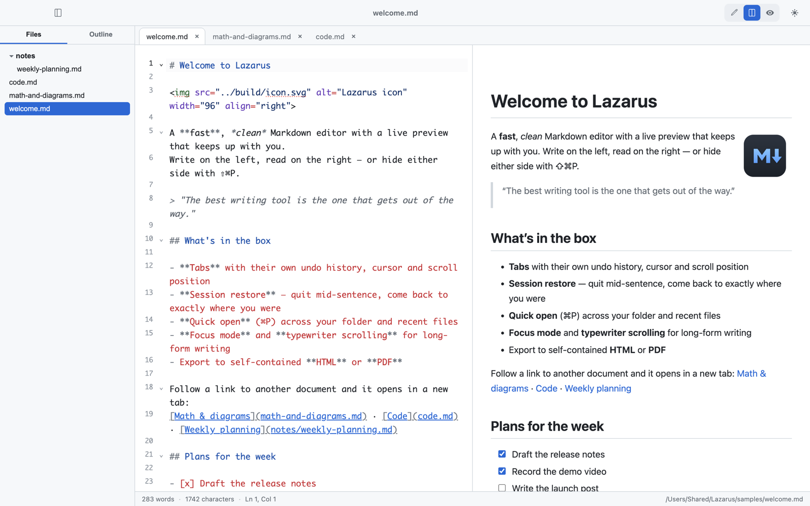
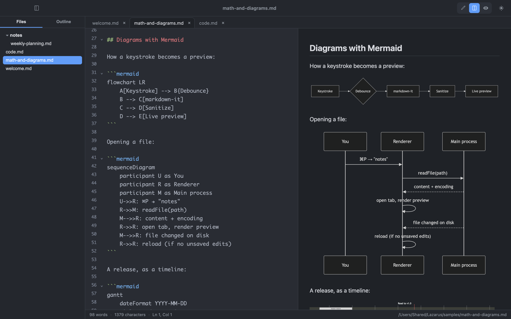
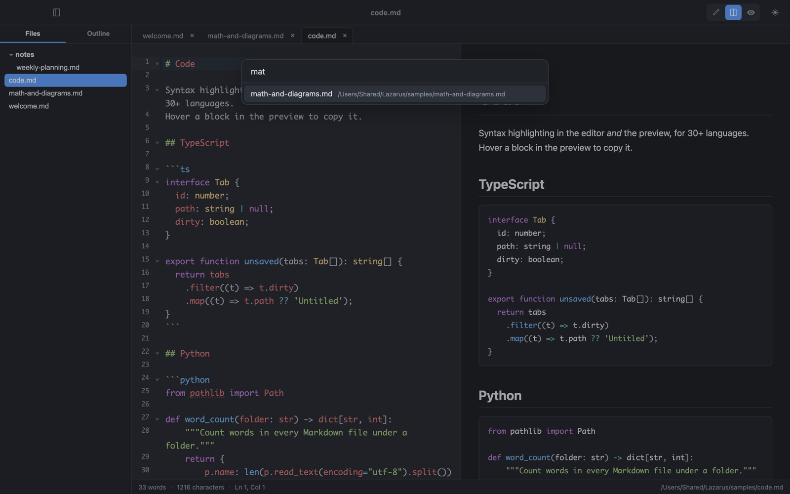

# Lazarus

A fast, private Markdown editor for macOS. No account, no telemetry, just files.
Built with Electron, CodeMirror 6, and markdown-it.

<picture>
  <source media="(prefers-color-scheme: dark)" srcset="docs/screenshots/hero-dark.png">
  
</picture>

Reborn from the best organs of an earlier 82,000-line prototype —
rebuilt as ~2,500 lines of JavaScript that a single reader can hold in their head.

## Private by design

- **Free and open source** — MIT licensed. No trial, no license key, no subscription.
- **No account** — nothing to sign up for or log into.
- **No telemetry** — no analytics, no crash reporting, no usage tracking.
- **Never phones home** — no update checks, no network requests of its own. Your files stay on your disk.
- **Just files** — plain `.md` files in your own folders. No vault, no database, no lock-in.

The only network traffic comes from your documents: remote images
(``) load like they would in a browser, and clicking a web
link opens it in your default browser. And because the code is ~2,500
lines of JavaScript, you can check all of this yourself.

## Install

Download the latest `.dmg` from [Releases](../../releases/latest), open it, and
drag Lazarus Markdown to Applications. The app is signed and notarized by Apple.

Requires macOS 13 Ventura or later on Apple Silicon.

## Features

- **Tabs** — open many documents at once; each tab keeps its own undo history, cursor, scroll position, and dirty state
- **Session restore** — open tabs, folder, and scroll positions survive restarts
- **Drag & drop** — drop markdown files onto the window to open them in tabs
- **Live preview** — GitHub-flavored rendering with synced scrolling; relative image paths resolve against the current document
- **Formatting shortcuts** — bold/italic/strikethrough/code, headings, lists, tasks, quotes, and smart links, all with toggle behavior
- **Slash menu** — type `/` at the start of a line for tables, code fences, mermaid, math blocks, callouts, and more
- **Focus mode & typewriter scrolling** — dim everything but the current paragraph; keep the active line centered
- **Quick open** — ⌘P fuzzy file switcher across the open folder and recently opened files
- **Syntax highlighting** — CodeMirror 6 in the editor, Prism in the preview (30+ languages)
- **Math** — KaTeX, inline `$…$` and display `$$…$$`
- **Diagrams** — Mermaid code blocks render lazily as SVG
- **Task lists** — click a checkbox in the preview and it edits the source
- **Callouts** — GitHub-style `> [!NOTE]`, `[!TIP]`, `[!WARNING]` and friends
- **Table of contents** — put `[[toc]]` anywhere for a linked outline of the document
- **Sidebar** — folder file tree and document outline with click-to-navigate
- **Dark / light themes** — follows the system, toggle with ⌘⇧D
- **Encoding-aware** — non-UTF-8 files are detected and decoded on open
- **Export** — self-contained HTML, or PDF via Electron's native `printToPDF` (no bundled second browser)
- External file changes reload automatically when you have no unsaved edits

| Math & diagrams | Quick open |
| --- | --- |
|  |  |

Want to try these yourself? Open the [`samples/`](samples) folder in Lazarus.

## Keyboard shortcuts

| Action | Shortcut | Action | Shortcut |
| --- | --- | --- | --- |
| New tab | ⌘N | Bold | ⌘B |
| Open | ⌘O | Italic | ⌘I |
| Open folder | ⇧⌘O | Inline code | ⌘E |
| Quick open | ⌘P | Link | ⌘K |
| Save | ⌘S | Heading 1–6 | ⌘1 … ⌘6 |
| Close tab | ⌘W | List | ⇧⌘L |
| Next / prev tab | ⌃Tab / ⌃⇧Tab | Task list | ⇧⌘T |
| Find | ⌘F | Blockquote | ⇧⌘. |
| Toggle sidebar | ⌘\ | Cycle preview | ⇧⌘P |
| Toggle dark mode | ⇧⌘D | Strikethrough | ⇧⌘X |
| Focus mode | ⇧⌘F | Typewriter | ⇧⌘Y |

## Development

```bash
npm install
npm run dev      # develop with hot reload
npm run build    # production build to out/
npm start        # preview the production build
npm test         # run the test suite
npm run icon     # regenerate build/icon.icns from build/icon.svg
npm run dist     # package a macOS .dmg into dist/
```

`npm run dist` signs with the Developer ID Application certificate in the
login keychain and notarizes via Apple. Notarization credentials live in the
keychain profile `lazarus`:

```bash
xcrun notarytool store-credentials lazarus --key ~/Downloads/AuthKey_XXXXXXXXXX.p8 \
  --key-id XXXXXXXXXX --issuer <issuer-uuid>
APPLE_KEYCHAIN_PROFILE=lazarus npm run dist
```

## Architecture

One explicit initialization path, no duplicate systems.

```
src/
  main/          Electron main: window, menu; fileOps.js IPC + per-file watchers;
                 fileUtils.js pure helpers (encoding detection, link resolution);
                 store.js session + preferences in userData/state.json
  preload/       contextBridge API — the only bridge between worlds
  renderer/src/
    main.js      orchestrator: wires editor → tabs → preview → sidebar → status bar
    editor.js    CodeMirror 6 setup + per-tab EditorState swap
    markdown.js  markdown-it pipeline + DOMPurify sanitization
    katex-inline.js  KaTeX CSS with fonts as data URIs for self-contained export (lazy)
    prism-setup.js  Prism core + languages, statically imported in order
    preview.js   debounced render, mermaid (lazy), copy buttons, task toggles
    formatting.js   pure text-transform commands (bold, headings, lists, links)
    tabs.js      tab model + strip rendering
    quickopen.js fuzzy file switcher
    sidebar.js   file tree + outline
```

The pure logic (`formatting.js`, `quickopen.js`, `sidebar.js`'s heading
extraction) is covered by unit tests; run `npm test`.

### House rules

1. No `-improved` / `-optimized` / `-enhanced` twin files. Heal the organ, never grow a spare.
2. One error-handling path. If a subsystem fails, it degrades in place — it must never block initialization.
3. Everything statically imported unless it's genuinely heavy (Mermaid).
4. Tests stay green.
