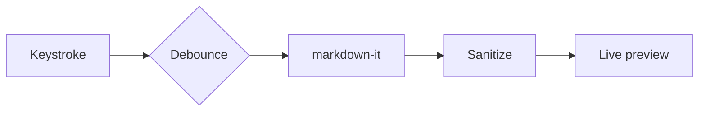
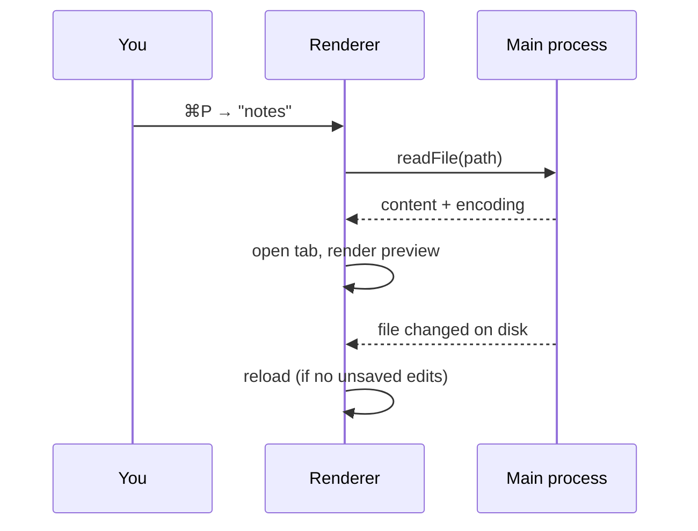
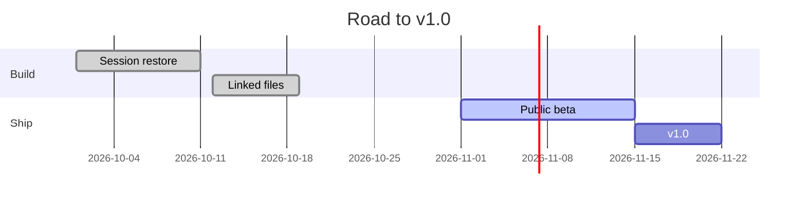

# Math & Diagrams

## Math with KaTeX

Euler's identity, $e^{i\pi} + 1 = 0$, sits comfortably inline. Display math
gets its own line:

$$
\int_{-\infty}^{\infty} e^{-x^2}\,dx = \sqrt{\pi}
$$

The quadratic formula solves $ax^2 + bx + c = 0$:

$$
x = \frac{-b \pm \sqrt{b^2 - 4ac}}{2a}
$$

And a little linear algebra:

$$
\begin{pmatrix} \cos\theta & -\sin\theta \\ \sin\theta & \cos\theta \end{pmatrix}
\begin{pmatrix} x \\ y \end{pmatrix}
=
\begin{pmatrix} x\cos\theta - y\sin\theta \\ x\sin\theta + y\cos\theta \end{pmatrix}
$$

## Diagrams with Mermaid

How a keystroke becomes a preview:

Opening a file:

A release, as a timeline:

